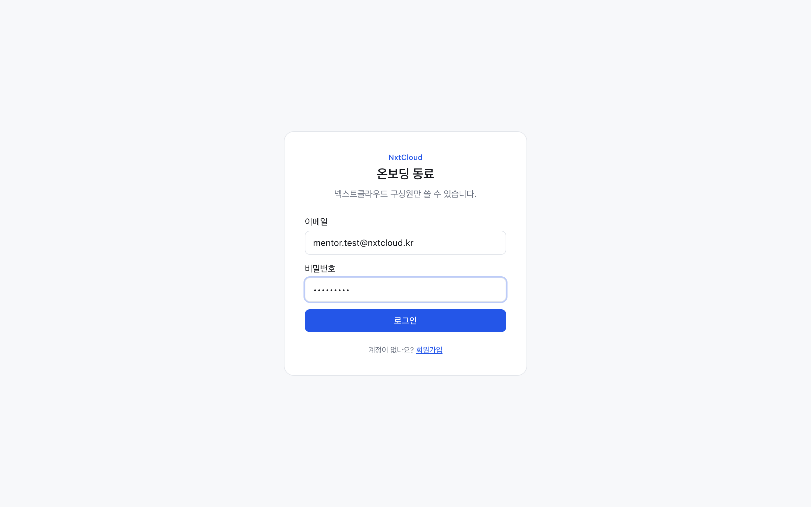
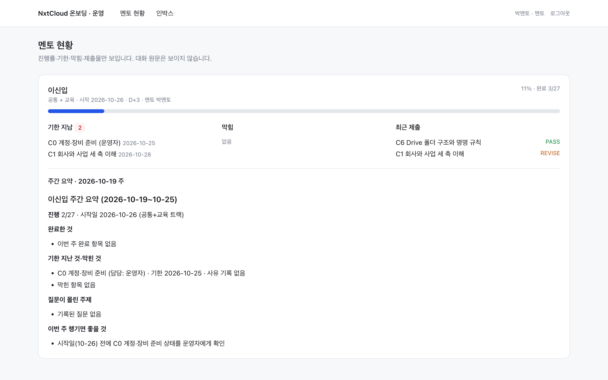
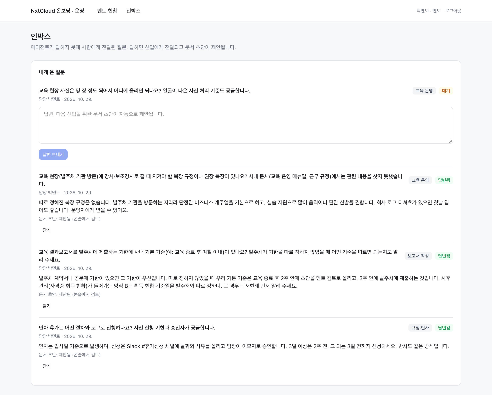
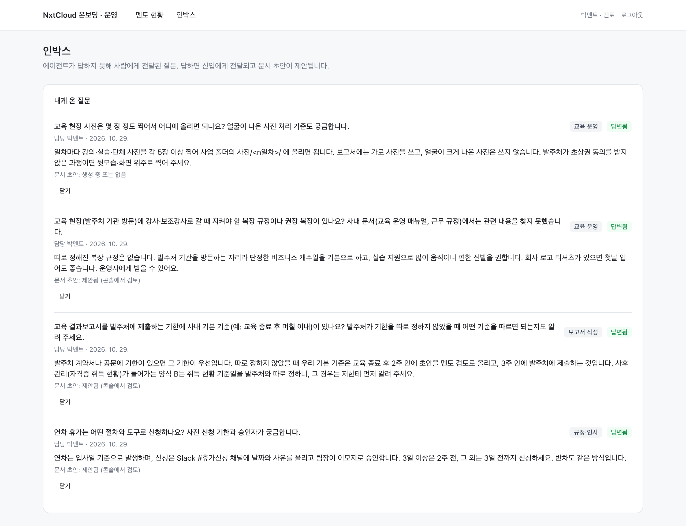
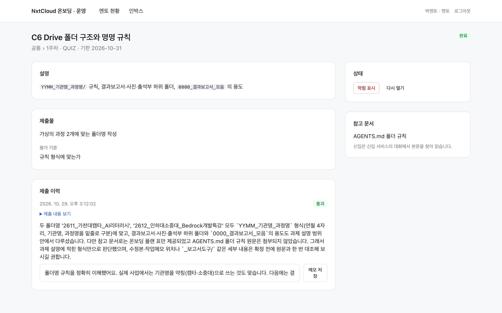
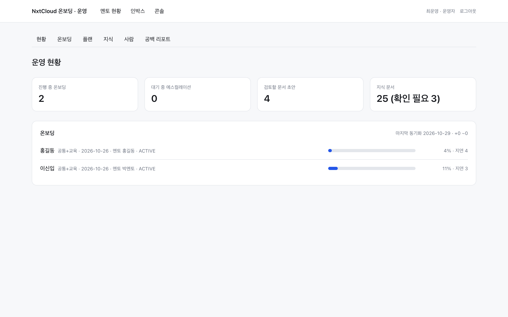
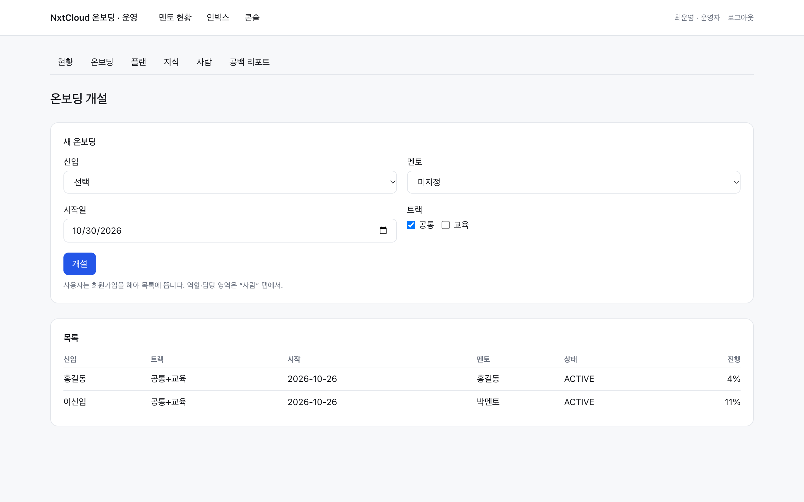
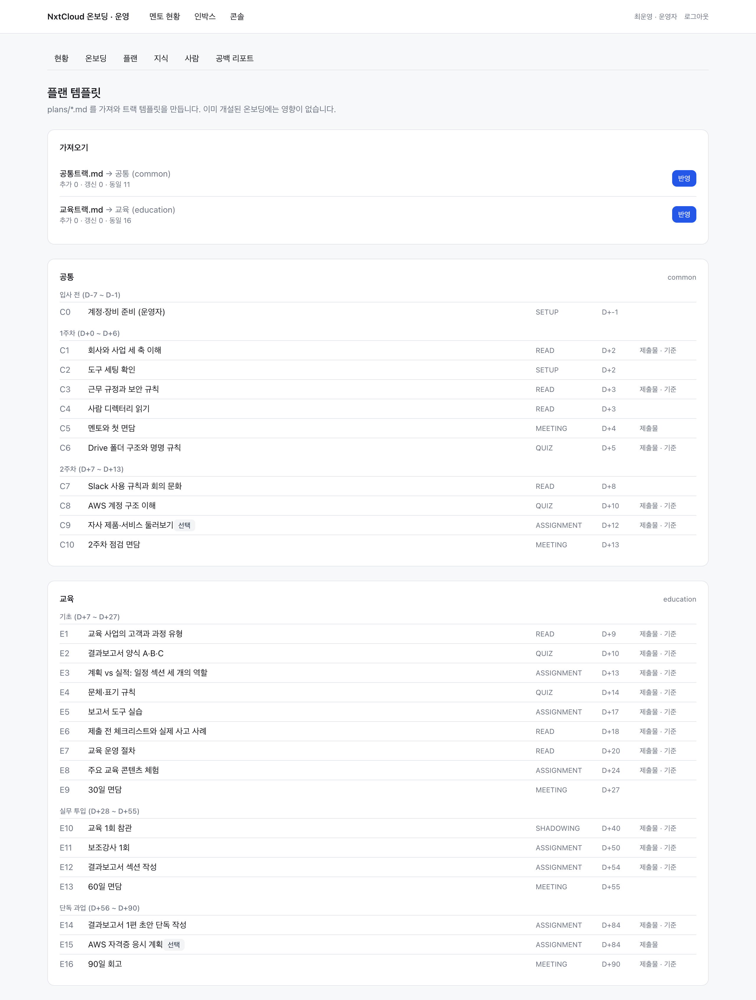
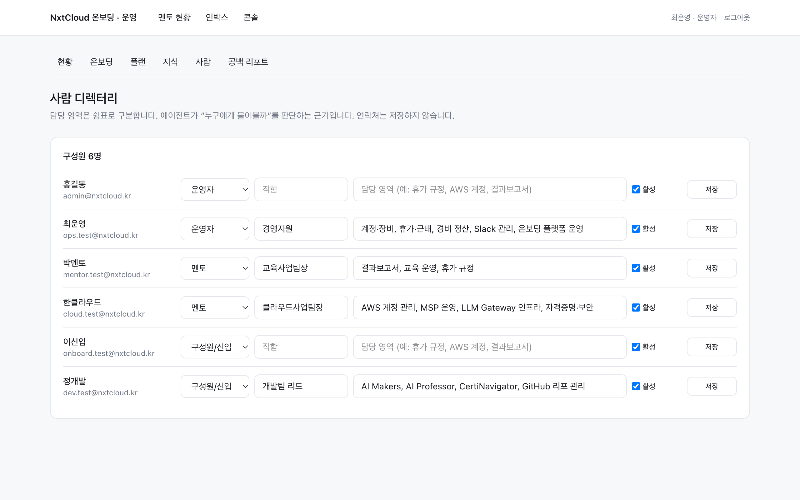
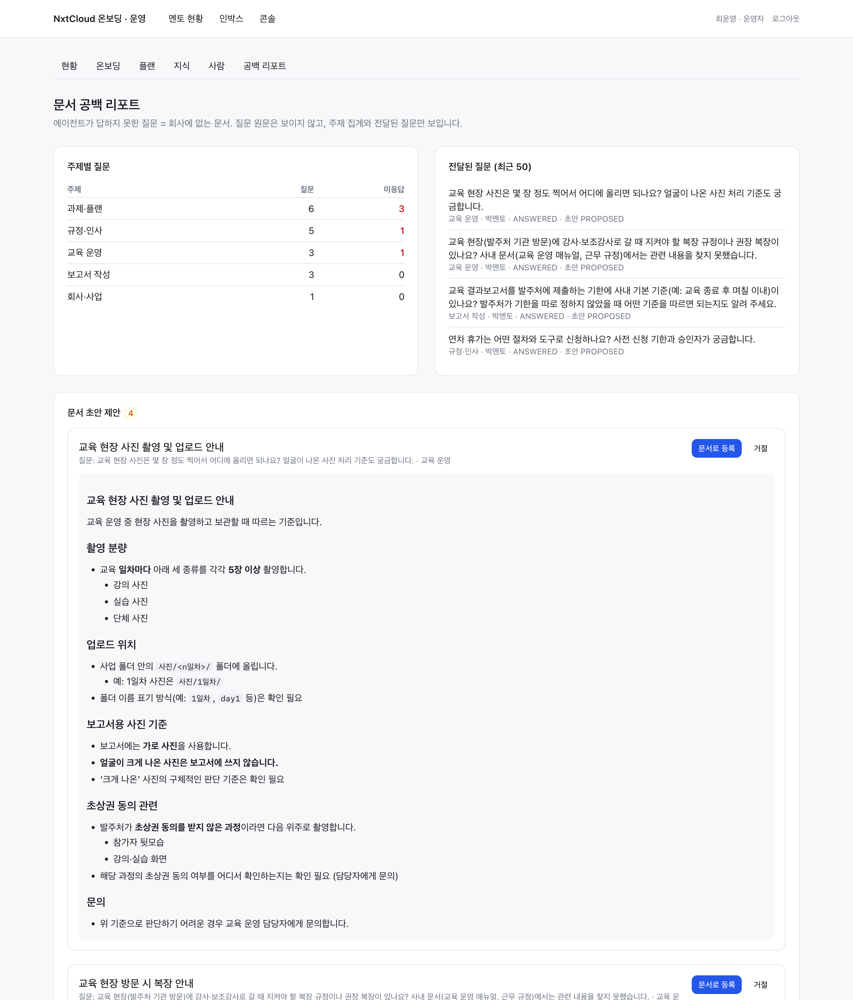

# NxtCloud 온보딩 — 사수·운영 서비스

신입 온보딩 플랫폼의 **멘토(사수)와 운영자** 쪽 서비스입니다. 멘토는 담당 신입의 진행 상황을 보고 전달된 질문에 답하며, 운영자는 온보딩 개설 · 플랜 · 지식 문서 · 사람 디렉터리 · 문서 공백 리포트를 관리합니다.
플랫폼 공용 자산(온보딩 플랜 `plans/`, 사내 문서 초안 `knowledge/`, 지식 수집 스크립트 `ingest/`, 설계 문서 `docs/`)과 공용 인프라(VPC · RDS · Secrets)도 이 프로젝트가 소유합니다.

신입 쪽 화면(홈 · 여정 · 과제 · 에이전트 대화)은 별도 리포 **onboarding-newcomer**(신입 서비스)에 있습니다. 두 서비스는 **같은 Postgres** 를 씁니다.

| 구분 | 내용 |
|---|---|
| 사용자 | 멘토 · 운영자 (신입이 로그인하면 신입 서비스로 안내) |
| 화면 | 멘토 현황 · 인박스 · 과제(상태 조정·메모) · 운영자 콘솔 6탭 · 가입/로그인 |
| 백그라운드 | 지식 인제스트(섹션 분할·개인정보 필터·Claude 요약), 에스컬레이션 답변 → 문서 초안, 주간 요약 |
| 스택 | Next.js 16 · TypeScript · Prisma 6 · PostgreSQL 16 (pg_trgm) · Auth.js 5 · `@anthropic-ai/sdk` · Python 3.9 (ingest) |
| 배포 | Docker 이미지 → ECS Fargate (ARM64) · ALB · Route53, Terraform (`infra/`, 공용 자원 포함) |

---

## 화면과 기능

### 1. 가입·로그인



- 회사 이메일(`@nxtcloud.kr`)만 가입할 수 있고 계정은 신입 서비스와 공유됩니다. 역할은 운영자가 콘솔 › 사람 탭에서 지정합니다.
- 운영자가 없을 때 `SEED_ADMIN_EMAIL` 로 가입하면 운영자가 됩니다.
- 로그인하면 멘토는 멘토 현황, 운영자는 콘솔로 갑니다. 구성원(신입)은 신입 서비스 주소를 안내받습니다.

### 2. 멘토 현황



- 담당 신입마다 진행률, **기한 지남**, **막힘**(신입이 적은 사유), **최근 제출**과 자동 검토 판정(PASS · REVISE)을 봅니다.
- **주간 요약**은 월요일 배치가 만듭니다. 완료한 것 · 기한 지난 것·막힌 것 · 질문이 몰린 주제 · 이번 주 챙기면 좋을 것.
- 대화 원문은 보이지 않습니다. 원문에서 파생된 요약·집계는 원문을 보지 않고 만듭니다.

### 3. 인박스 — 전달된 질문



- 에이전트가 사내 문서에서 답을 찾지 못해 신입이 전달한 질문이 담당자별로 쌓입니다. 운영자는 전체를 봅니다.
- 질문은 에이전트가 개인 사정을 빼고 다듬은 일반형이며 주제 태그가 붙습니다.

### 4. 인박스 — 답변하면 신입에게 전달되고 문서 초안이 제안됨



- 답변은 신입 서비스 인박스로 전달됩니다.
- 동시에 Claude 가 답변을 **사내 문서 초안**으로 정리해 운영자 콘솔 › 공백 리포트에 제안합니다. 운영자가 수락하면 지식베이스에 등록되어 다음 사람은 에이전트에게서 바로 답을 받습니다.
- 답변이 끝난 질문은 닫을 수 있습니다.

### 5. 과제 — 상태 조정과 멘토 메모



- 멘토 현황에서 과제를 열면 제출 이력과 자동 검토 판정이 보이고, 제출물마다 **멘토 메모**를 남길 수 있습니다. 메모는 신입 과제 화면에 보입니다.
- 상태는 완료 처리 · 건너뛰기(선택 과제) · 다시 열기 · 막힘 표시로 조정할 수 있습니다. 제출·자동 검토는 신입 서비스가 합니다.

### 6. 콘솔 — 현황



- 진행 중 온보딩, 대기 중 에스컬레이션, 검토할 문서 초안, 지식 문서 수(개인정보 확인 필요 건수 포함)를 한눈에 봅니다.

### 7. 콘솔 — 온보딩 개설



- 신입 · 멘토 · 트랙(공통 · 교육) · 시작일을 정하면 플랜 템플릿에서 과제가 **시작일 기준 기한**과 함께 생성됩니다.
- 개설된 온보딩 목록과 진행률을 봅니다. 운영자 행위는 감사 로그에 남습니다.

### 8. 콘솔 — 플랜 가져오기



- `plans/*.md` 를 읽어 트랙 › 단계 › 과제 템플릿을 만듭니다. 반영 전에 **추가 · 갱신 · 동일** 건수를 미리 보여 주고, 이미 개설된 온보딩에는 영향을 주지 않습니다.
- 플랜 파일 형식: `track:` / `name:` 머리말 + `## Phase: 이름 (D+a ~ D+b)` + 9열 표(ID · 제목 · 유형 · 기한 · 설명 · 제출물 · 평가 기준 · 참고 문서 · 선택). 자세한 규칙은 `docs/02_데이터모델.md` §5.

### 9. 콘솔 — 지식


- 인제스트된 문서의 요약 · 태그 · 가시성(전 직원 · 트랙 한정 · 운영자만) · 개인정보 의심 플래그를 관리합니다. 플래그가 선 문서는 운영자가 확인하기 전까지 에이전트 답변에서 제외됩니다.
- 마크다운 수동 등록과 동기화 이력(소스별 생성 · 갱신 · 제외 건수)도 여기 있습니다.

### 10. 콘솔 — 사람 디렉터리



- 역할 · 직함 · **담당 영역** · 활성 여부. 담당 영역은 에이전트가 "누구에게 물어볼까"를 판단하는 근거입니다. 연락처는 저장하지 않습니다.
- (캡처의 운영자 실명·이메일은 자리표시자로 가렸습니다.)

### 11. 콘솔 — 문서 공백 리포트와 초안 수락



- 에이전트가 답하지 못한 질문 = 회사에 없는 문서. **주제별 질문 수와 미응답 수**, 전달된 질문 목록을 봅니다. 질문 원문은 보이지 않습니다.
- 멘토 답변에서 생성된 **문서 초안**을 읽고 **문서로 등록**하거나 거절합니다. 등록하면 지식베이스에 수동 문서로 들어갑니다.

---

## 지식 파이프라인

```
운영자 맥: ingest/ingest.py ──▶ hwpx·docx(doctext.py) · md · pdf 를 텍스트로 ──▶ POST /api/admin/ingest (Bearer INGEST_TOKEN)
서버: 섹션 분할(제목 기호·표 경계) → 파일명·섹션 단위 개인정보 필터 → Claude 요약·태그·개인정보 판정 → Document/DocSection 저장 (pg_trgm 인덱스)
```

```bash
# 사내 문서 초안 (이 리포의 knowledge/)
python3 ingest/ingest.py --source github --root knowledge --prefix cnlab_x_nxtcloud/knowledge --include md --token "$INGEST_TOKEN"
# Drive 마운트의 결과보고서 폴더 (hwpx·docx 는 doctext.py 로 변환 — 상위 폴더의 _보고서도구/doctext.py 를 자동 탐색, 없으면 --doctext 또는 DOCTEXT 환경 변수로 지정)
python3 ingest/ingest.py --source drive --root "$DRIVE/0000_결과보고서_모음" --token "$INGEST_TOKEN"
# 다른 리포의 md
python3 ingest/ingest.py --source github --root /path/to/nxtcloud-llm-gateway --prefix nxtcloud-llm-gateway --include md --token "$INGEST_TOKEN"
python3 ingest/ingest.py ... --dry      # 전송 없이 대상만 출력
python3 ingest/ingest.py ... --force    # 해시 무시, 요약 재생성
```

- 파일명에 `출석부 · 명단 · 연락처 · 개인정보 · 계약서 · 견적 · accessKeys` 가 있으면 건너뜁니다. 본문에 이메일·전화가 몰린 섹션은 그 섹션만 제외합니다.
- 바뀌지 않은 문서(해시 동일)는 건너뜁니다. 기본 서버는 `http://localhost:3001`, 운영은 `--server https://<멘토 서비스>`.
- 검색은 임베딩 없이 카탈로그 선택 + trigram 키워드 검색으로 동작합니다. 문서가 수백 건을 넘으면 임베딩을 추가합니다 (2단계).

### `knowledge/` — 사내 문서 초안

플랜이 참조하는 사내 문서 8건(회사소개 · 도구 세팅 가이드 · 근무규정·보안규칙 요약 · 커뮤니케이션 가이드 · 교육 운영 매뉴얼 · 교육 과정 카탈로그 · 자사 제품·서비스 · 온보딩 플랫폼 사용법)의 **초안**입니다. 리포에 있는 실제 자료에서 확인되는 내용만 쓰고, 알 수 없는 값은 `[[확인 필요]]` 로 남겼습니다. 운영자가 실제 값으로 채운 뒤 다시 인제스트합니다.

---

## 배치

| 작업 | 엔드포인트 / 명령 | 운영 스케줄 |
|---|---|---|
| 멘토 주간 요약 | `POST /api/admin/cron/weekly-summary` (Bearer `CRON_TOKEN`) · `npm run summary:weekly` | 월요일 06:00 KST (EventBridge) |
| 대화 보존 정리 | 신입 서비스의 `/api/admin/cron/retention` | 매일 03:00 KST (신입 스택) |

---

## 로컬 실행

DB 마이그레이션 · 시드(운영자 · 플랜) · 테스트 계정은 **이 서비스에서 한 번** 합니다. 신입 서비스는 같은 DB 에 붙기만 합니다.

```bash
# 1) Postgres (두 서비스가 공유. compose 프로젝트 이름 onboard)
docker compose up -d postgres                 # localhost:5433, user/pw/db = onboard

# 2) 앱
cd web
cp .env.example .env                          # DATABASE_URL · ANTHROPIC_API_KEY · AUTH_SECRET · SEED_ADMIN_EMAIL · INGEST_TOKEN · CRON_TOKEN
npm install
npm run db:migrate                            # 마이그레이션 (pg_trgm · trigram 인덱스 포함)
npm run db:seed                               # 최초 운영자 + ../plans/*.md → 트랙 템플릿
npx tsx scripts/dev-fixture.ts                # (선택) 테스트 계정 5개 + 신입 온보딩, 비밀번호 Test12345
npm run dev                                   # http://localhost:3001

# 3) 지식 수집 → 위 "지식 파이프라인"
# 4) 신입 서비스: 리포 onboarding-newcomer 의 README 참고
```

- 로컬 테스트 계정(production 에서는 만들지 않음): `mentor.test@nxtcloud.kr`(멘토) · `ops.test@nxtcloud.kr`(운영자) · `cloud.test@nxtcloud.kr`(멘토, 클라우드) · `dev.test@nxtcloud.kr`(구성원, 개발) · `onboard.test@nxtcloud.kr`(신입).
- `npm run typecheck` · `npm run lint` · `npm run build`(standalone).

### 환경 변수 (`web/.env.example`)

| 변수 | 용도 |
|---|---|
| `DATABASE_URL` | 신입 서비스와 같은 Postgres |
| `ANTHROPIC_API_KEY` · `CLAUDE_MODEL` | 문서 요약·초안·주간 요약 |
| `AUTH_SECRET` · `AUTH_URL` | 세션 서명 · 서비스 주소 (`http://localhost:3001`) |
| `ALLOWED_EMAIL_DOMAIN` | 가입 허용 도메인 |
| `SEED_ADMIN_EMAIL` · `SEED_ADMIN_NAME` · `SEED_ADMIN_PASSWORD` | 시드가 만드는 최초 운영자 (비밀번호는 비우면 가입 화면에서) |
| `INGEST_TOKEN` | `ingest.py` 가 쓰는 Bearer 토큰 |
| `CRON_TOKEN` | 주간 요약 엔드포인트의 Bearer 토큰 |
| `NEWCOMER_APP_URL` | 구성원이 들어왔을 때 안내할 신입 서비스 주소 |
| `PLANS_DIR` | 콘솔 플랜 가져오기가 읽는 폴더 (기본 `../plans`, 이미지에서는 `/app/plans`) |

---

## 배포 (`infra/`, Terraform) — 공용 자원 포함, 먼저 apply

이 스택이 만드는 것: **공용** VPC(public · private · database 서브넷, 단일 NAT) · RDS Postgres 16(db.t4g.micro, 암호화, 7일 백업, 삭제 보호) · Secrets Manager(`<name>/generated`: DB URL · AUTH_SECRET · INGEST_TOKEN · CRON_TOKEN, `<name>/app`: ANTHROPIC_API_KEY), **서비스** ECR · ECS 클러스터·서비스(Fargate ARM64) · ALB·ACM·Route53 · EventBridge(주간 요약). 신입 서비스 리포(onboarding-newcomer)의 `infra/` 스택은 공용 자원을 이름·태그로 찾아 씁니다.

```bash
# 1) 이미지 (컨텍스트는 이 폴더 — plans/ 를 이미지에 넣는다, linux/arm64)
aws ecr get-login-password --region ap-northeast-2 | docker login --username AWS --password-stdin <account>.dkr.ecr.ap-northeast-2.amazonaws.com
docker buildx build --platform linux/arm64 -f web/Dockerfile -t <ecr_repository_url>:v1 . --push

# 2) 인프라
cd infra && cp terraform.tfvars.example terraform.tfvars   # app_hostname · newcomer_hostname · seed_admin_email. backend.tf 주석 해제
TF_VAR_anthropic_api_key=sk-ant-... terraform init && terraform apply -var image_tag=v1
#    키를 환경변수로 주지 않았다면 apply 후 Secrets Manager <name>/app 에 입력하고 두 서비스를 재배포

# 3) 초기화 — 컨테이너가 시작할 때 prisma migrate deploy 를 수행
#    https://<app_hostname>/signup 에서 seed_admin_email 로 가입 → 운영자
#    콘솔 › 플랜 가져오기 → 사람 탭에서 담당 영역 입력 → 온보딩 개설
#    ingest.py --server https://<app_hostname> --token <generated 시크릿의 INGEST_TOKEN>

# 4) 신입 스택: 리포 onboarding-newcomer 의 README › 배포
```

- 기본 도메인 `onboard-mentor.nxtcloud.kr`. `project_name` · `environment` 는 신입 스택과 같아야 합니다.
- RDS 보안그룹은 inline 규칙 대신 독립 규칙을 써서 신입 스택이 자기 ECS 보안그룹을 추가할 수 있습니다.
- Terraform state 는 S3 백엔드 권장(`backend.tf` 주석). ALB 가 서비스별로 하나씩 있어 고정비가 ALB 1개분 늘어납니다.

---

## 구조

```
onboarding-mentor/            (리포 루트)
├─ web/
│  ├─ src/app/(app)/        mentor(현황) · inbox · tasks/[id] · admin/{현황, onboardings, tracks, documents, people, gap-report}
│  ├─ src/app/api/          admin/ingest · admin/cron/weekly-summary
│  ├─ src/app/actions/      admin(플랜·온보딩·문서·초안) · escalations(답변 → 초안) · tasks(상태·메모) · auth
│  ├─ src/agent/            client · summarize(문서 요약·태그·PII 판정) · draft(답변 → 문서 초안) · summary(주간 요약) · review(판정 형식)
│  ├─ src/services/         admin · knowledge · onboardings · tasks · escalations · people
│  ├─ src/lib/              plans/(parse·import) · knowledge/(sections·pii) · session · password · dates · cron · prisma
│  ├─ prisma/               스키마·마이그레이션·seed.ts (신입 서비스와 동일한 사본 + 시드)
│  ├─ scripts/              dev-fixture.ts · weekly-summary.ts
│  └─ Dockerfile            Next standalone + Prisma CLI + plans/, 시작 시 migrate deploy
├─ infra/                   Terraform (공용 VPC·RDS·Secrets + 서비스)
├─ plans/                   공통트랙.md · 교육트랙.md
├─ knowledge/               사내 문서 초안 8건
├─ ingest/ingest.py         지식 수집 스크립트 (표준 라이브러리만)
├─ docs/                    00_기획 · 01_MVP_명세 · 02_데이터모델 · 03_아키텍처 · screenshots/
└─ docker-compose.yml       로컬 Postgres
```

- `prisma/` · `src/lib/` 공통 모듈 · `src/components/ui.tsx` 는 신입 서비스와 같은 사본입니다. **스키마를 바꾸면 양쪽을 같이 고치고**, 새 마이그레이션은 여기서 만들어 신입 서비스로 복사합니다.
- 설계 문서: [`docs/00_기획.md`](docs/00_기획.md)(결정 기록) · [`docs/01_MVP_명세.md`](docs/01_MVP_명세.md)(범위·에이전트 설계·가시성 규칙) · [`docs/02_데이터모델.md`](docs/02_데이터모델.md) · [`docs/03_아키텍처.md`](docs/03_아키텍처.md)(스택·API·배포·구현 현황).
